<!--
SPDX-FileCopyrightText: 2026 DX-OS Open-Core contributors
SPDX-License-Identifier: CC-BY-4.0
-->

# DX-OS Open-Core (v1.1.0)

> **Hệ điều hành Chuyển đổi số bằng Công nghệ Lõi nguồn mở**  
> *Dự án dự thi Olympic Tin học Sinh viên Việt Nam 2026 – Khối Phần mềm nguồn mở (PMNM)*  
> *Đội thi: DX-CORE Team | Trường: Đại học Phenikaa*  
> *Ghi chú quan trọng: Mọi thông tin về tổ chức, người dùng, hồ sơ và giấy phép trong hệ thống là hư cấu phục vụ mô phỏng cuộc thi và không có giá trị pháp lý.*

---

## 1. Giới thiệu

**DX-OS Open-Core (v1.1.0)** là một nền tảng Hệ điều hành Chuyển đổi số (Digital Transformation Operating System) nguồn mở hoàn toàn, được thiết kế theo kiến trúc PaaS không đầu (headless core platform) phục vụ các cơ quan chính quyền đô thị và đơn vị sự nghiệp công.

Ở phiên bản v1.1.0, toàn bộ hệ thống được củng cố theo nguyên tắc **Fail-Closed**: loại bỏ mã giả, mock connection và lưu trữ RAM tạm; tích hợp thực tế với Keycloak SSO (RS256 JWKS), **PAdES qua SoftHSM2/PKCS#11** (mặc định demo) hoặc OpenBao Transit KMS (legacy), ClamAV Antivirus thật (INSTREAM), Flowable BPMN 2.0 đa thuê ước với phân tách nhiệm vụ (SoD), và cách ly dữ liệu triệt để qua Row-Level Security (RLS) PostgreSQL. Bảng điều hành [D] gọi metrics-api thật; Trợ lý [I] gọi assistant RAG thật; toàn bộ giao diện chạy offline, không phụ thuộc CDN ngoại mạng.

---

## 2. Bối cảnh OLP PMNM 2026 và Đề thi

- **Cuộc thi:** Olympic Tin học Sinh viên Việt Nam 2026 (OLP 2026) – Khối Phần mềm nguồn mở (PMNM).
- **Cơ quan tổ chức:** Hội Tin học Việt Nam (VAIP); Cơ quan thường trực: Câu lạc bộ Phần mềm Tự do Nguồn mở Việt Nam (VFOSSA).
- **Đề bài:** *"Xây dựng Hệ điều hành Chuyển đổi số bằng Công nghệ Lõi nguồn mở (DX-OS Open-Core)"*.
- **Thông báo đề thi:** [https://www.vfossa.vn/tin-tuc/de-thi-phan-mem-nguon-mo-olp-2026-798.html](https://www.vfossa.vn/tin-tuc/de-thi-phan-mem-nguon-mo-olp-2026-798.html)
- **Hạn nộp bài:** 17:00 Chủ nhật 06/12/2026.

---

## 3. Vấn đề thực tiễn

Theo định hướng Luật Xây dựng 2025 (hiệu lực 01/7/2026) và Nghị định số 217/2026/NĐ-CP:
1. Thẩm quyền cấp giấy phép xây dựng nhà ở riêng lẻ được phân cấp mạnh mẽ về cấp xã/phường, với thời hạn tối đa rút ngắn xuống còn 7 ngày làm việc (thẩm định 3 ngày, bổ sung tối đa 1 lần trong 2 ngày).
2. Khi thủ tục cấp phép được đẩy nhanh và trực tuyến hóa 100%, **công tác hậu kiểm công trường bắt buộc phải chặt chẽ và thông minh hơn**.
3. Các cơ quan quản lý đô thị cấp cơ sở đối mặt với thách thức: thiếu nhân lực thanh kiểm tra hiện trường liên tục; khó kiểm soát tiếng ồn công trường và bụi mịn PM10/PM2.5 theo quy chuẩn môi trường QCVN 26:2025/BNNMT và QCVN 05:2023/BTNMT; nguy cơ lạm quyền, rò rỉ dữ liệu cá nhân của người dân khi phân công thẩm định.

---

## 4. Giải pháp và Điểm nổi bật

DX-OS Open-Core giải quyết bài toán trên bằng cách kết hợp sức mạnh của công nghệ lõi nguồn mở:

1. **4 Khoảnh khắc Bảo mật & Kiểm soát Rủi ro (Zero-Trust):**
   - **Cửa ngõ kiểm dịch tệp (Quarantine at the Gate):** 100% tệp đính kèm hồ sơ qua ClamAV INSTREAM trước khi vào kho lưu trữ; tệp độc hại (như EICAR) bị chặn đứng ngay lập tức tại mã lỗi `422`.
   - **Từ chối có lưu vết (Audited 403 & Break-Glass):** Thẩm định viên không được phân công hồ sơ sẽ bị từ chối truy cập (403), tự động ghi nhật ký vi phạm an toàn; cơ chế "truy cập khẩn cấp" có phê duyệt từ lãnh đạo và tự hết hạn sau thời gian ấn định (Time-To-Live).
   - **Phân tách nhiệm vụ tuyệt đối (Separation of Duties - SoD):** Thẩm định viên hồ sơ bị cấm hoàn thành nhiệm vụ phê duyệt cấp phép của Lãnh đạo (`dx:sodExclude`), ngăn chặn hoàn toàn hiện tượng "vừa đá bóng vừa thổi còi".
   - **Chuỗi kiểm toán bất biến & Niêm phong WORM:** Mọi hành vi tạo/sửa dữ liệu được băm chuỗi SHA-256 (`prev_hash || row_json`) trong cùng giao dịch cơ sở dữ liệu. Bất kỳ can thiệp thô nào vào bảng đều bị phát hiện vị trí sai lệch tức thì qua `make verify`.
2. **Quyền Chủ thể Dữ liệu (DSAR / Data Subject Rights):**
   - Người dân có không gian riêng để theo dõi sự đồng ý (consent), rút sự đồng ý và gửi yêu cầu xem/sửa/xóa dữ liệu cá nhân theo tinh thần Nghị định 356/2025, có đồng hồ đếm ngược thời hạn xử lý chuẩn xác theo số ngày làm việc.
3. **Hội tụ IT/OT (Smart Construction Post-Inspection):**
   - Tích hợp luồng cảm biến IoT (MQTT/TLS) giám sát tiếng ồn (dBA) và bụi mịn tại các công trình thi công. Khi tiếng ồn vượt ngưỡng 70 dBA ban ngày, quy trình tự động mở phiếu kiểm tra hiện trường chuyển ngay về danh sách công việc của Đội Trật tự xây dựng.
4. **Phả hệ Dữ liệu (OpenLineage) & Bảng Điều hành Lãnh đạo:**
   - Cung cấp **8 chỉ số điều hành** (hồ sơ mới, đang xử lý, quá hạn, thời gian xử lý TB, 403, phiếu kiểm tra, cảnh báo, vi phạm) với khả năng truy vết nguồn gốc dòng dữ liệu (lineage) từ sự kiện nóng tới kho phân tích lạnh (Lakehouse Parquet).
5. **Poka-yoke Giấy tờ & Kiểm soát Chất lượng Hồ sơ:**
   - Manifest giấy tờ khai báo theo thủ tục trong `app.yaml`; UI sinh **checklist động** và server kiểm tra lại **7 lớp** trước khi nhận hồ sơ (hiện diện, định dạng, ClamAV, hiệu lực, nhất quán chéo, trùng SHA-256, nghiệp vụ). Thiếu/sai giấy trả **422** kèm `{field, loai_giay, reason, action}`.
   - Cán bộ đánh giá **từng tệp** đạt/không đạt kèm lý do; tệp bổ sung tự động tăng `version`, giữ tệp cũ và liên kết `tep_goc_id`.

---

## 5. Kiến trúc Hệ thống

Hệ thống được tổ chức phân tầng rõ rệt:

```mermaid
flowchart TD
    subgraph Browser ["Trình duyệt Người dùng & Thiết bị"]
        ClientWeb["Ứng dụng Web Cấp phép (H & P)<br/>(Vue 3 SPA)"]
        DashboardWeb["Ứng dụng Bảng Điều hành (D & I)<br/>(Vue 3 SPA)"]
        PublicCheck["Trang Kiểm tra Công khai<br/>/kiem-tra/"]
        IoTDevices["Cảm biến Công trường (Sensor Sim)<br/>(MQTT TLS :8883)"]
    end

    subgraph Edge ["Tầng Biên Mạng (Edge Gateway)"]
        APISIX["Apache APISIX Gateway (:8080)<br/>- OIDC JWT Verify & Rate Limit<br/>- CSP / Security Headers / Prometheus"]
    end

    subgraph Layer1 ["Tầng 1 - Nền tảng Dịch vụ Lõi số (Headless PaaS)"]
        subgraph OSS_Services ["Dịch vụ Mã nguồn mở chạy riêng"]
            Keycloak["Keycloak 26.x (SSO / MFA / OIDC)"]
            PostgreSQL["PostgreSQL 16 + pgvector (RLS Core & App)"]
            PostgREST["PostgREST 12.x (REST API có RLS)"]
            Flowable["Flowable REST 7.x (BPMN Engine)"]
            NATS["NATS JetStream + MQTT Gateway"]
            SeaweedFS["SeaweedFS (S3 Staging / Files / WORM)"]
            ClamAV["ClamAV 1.4.x (Antivirus Daemon)"]
            OpenBao["OpenBao 2.2.x (Secrets / Transit legacy)"]
            SoftHSM["SoftHSM2 2.6.x (PKCS#11 + Test CA)"]
            Ollama["Ollama (bge-m3 / qwen2.5:0.5b)"]
        end

        subgraph Core_Thin_Services ["Dịch vụ Mỏng DX-OS (FastAPI / Python 3.12)"]
            SvcFiles["files (Quản lý tệp & Quét ClamAV)"]
            SvcDocSign["doc-sign (Sinh PDF & Ký PAdES qua SoftHSM/PKCS#11)"]
            SvcFlow["flow (Façade BPMN, SoD, SSE Events)"]
            SvcIngest["ingest (Xử lý IoT, Cảnh báo Ngưỡng)"]
            SvcNgsiLd["ngsi-ld (API Ngữ cảnh Thực thể Đô thị)"]
            SvcAudit["audit (Xác minh Chuỗi băm & Niêm phong WORM)"]
            SvcOutbox["outbox-relay (Đẩy sự kiện ra NATS JetStream)"]
            SvcWarm["export-warm (Đóng gói Lakehouse Parquet)"]
            SvcMetrics["metrics-api (Tính toán chỉ số & Phả hệ Lineage)"]
            SvcAssistant["assistant (Trợ lý Quy chuẩn RAG có Trích dẫn)"]
        end
    end

    subgraph Layer2 ["Tầng 2 - Không gian Năng lực số (H - P - D - I)"]
        AppCapPhep["apps/cap-phep (C3 Cấp phép & Hậu kiểm)"]
        AppDashboard["apps/bang-dieu-hanh (Bảng Điều hành & Trợ lý)"]
    end

    ClientWeb -->|HTTPS| APISIX
    DashboardWeb -->|HTTPS| APISIX
    PublicCheck -->|HTTPS| APISIX
    IoTDevices -->|MQTT/TLS| NATS

    APISIX --> SvcFiles
    APISIX --> SvcDocSign
    APISIX --> SvcFlow
    APISIX --> SvcIngest
    APISIX --> SvcNgsiLd
    APISIX --> SvcAudit
    APISIX --> SvcMetrics
    APISIX --> SvcAssistant
    APISIX --> PostgREST
    APISIX --> Keycloak

    SvcFiles --> SeaweedFS
    SvcFiles --> ClamAV
    SvcDocSign --> SoftHSM
    SvcDocSign -.->|legacy| OpenBao
    SvcFlow --> Flowable
    SvcFlow --> NATS
    SvcIngest --> PostgreSQL
    SvcIngest --> NATS
    SvcOutbox --> PostgreSQL
    SvcOutbox --> NATS
    SvcWarm --> SeaweedFS
    SvcAssistant --> Ollama
```



---

## 6. Thành phần và Giấy phép

Mã nguồn do đội ngũ DX-OS phát triển được phát hành theo giấy phép **GNU Affero General Public License v3.0 or later (AGPL-3.0-or-later)**. Toàn bộ các thành phần phụ thuộc đều có giấy phép mã nguồn mở tương thích (xem chi tiết tại [`THIRD_PARTY_LICENSES.md`](THIRD_PARTY_LICENSES.md)).

- **Cổng vào & Định danh:** Apache APISIX 3.11 (Apache-2.0), Keycloak 26.1 (Apache-2.0).
- **Cơ sở dữ liệu:** PostgreSQL 16 + pgvector (PostgreSQL License), PostgREST 12.2 (MIT).
- **Quy trình & Sự kiện:** Flowable 7.1 (Apache-2.0), NATS Server 2.10 (Apache-2.0).
- **Lưu trữ & Bảo mật:** SeaweedFS 3.86 (Apache-2.0), OpenBao 2.2 (MPL-2.0), SoftHSM2 2.6 (BSD-2-Clause), OpenSC 0.26 (LGPL-2.1), pyHanko 0.38 (MIT), python-pkcs11 0.10 (MIT), ClamAV 1.4 (GPL-2.0 chạy riêng).
- **Dịch vụ mỏng:** Python 3.12 + FastAPI (MIT / PSF-2.0 / AGPL-3.0-or-later).
- **Giao diện người dùng:** Vue 3, Vite, Tailwind CSS, TypeScript (MIT / Apache-2.0 / AGPL-3.0-or-later).

---

## 7. Yêu cầu Hệ thống

- **Hệ điều hành:** Linux (Ubuntu 22.04 / 24.04 LTS khuyến nghị), macOS hoặc Windows 10/11 với WSL2 hoặc Docker Desktop.
- **Phần mềm yêu cầu:**
  - **Docker Engine 26+ & Docker Compose v2.29+** (Yêu cầu duy nhất).
  - *Không yêu cầu cài Python, GNU Make, curl hay thư viện cryptography trên máy chủ host.* Toàn bộ công cụ quản trị, di trú dữ liệu, kiểm toán, sao lưu và phục hồi được đóng gói khép kín trong container `dxos/tools:1.0.0` và được điều khiển qua wrapper script tiện ích:
    - **Windows:** `.\dx.ps1 <lệnh>` (PowerShell)
    - **Linux/macOS:** `./dx.sh <lệnh>` hoặc `make <lệnh>`
- **Tài nguyên phần cứng:**
  - Cấu hình chạy Lõi tối thiểu (`profile: core`): RAM tối thiểu **8 GB**, CPU 4 cores.
  - Cấu hình chạy Toàn bộ (`core + ai + ops + sim`): RAM tối thiểu **16 GB**, CPU 6-8 cores.

---

## 8. Cài đặt Nhanh

### 8.1. Một lệnh duy nhất (khuyến nghị cho demo)

Windows — nhấp đúp `run.cmd`, hoặc chạy trong PowerShell:

```powershell
cd DXOS-OpenCore-C3
.\run.ps1
```

Script tự kiểm tra Docker Desktop, dừng stack cũ cùng tên, khởi tạo `.env`/secrets nếu thiếu, bật `DEMO_MODE`, chạy `init → up → app-install → seed → doctor`, chờ 6 dịch vụ thiết yếu healthy, kiểm tra gateway trả HTTP rồi mở trình duyệt.

Tùy chọn:

```powershell
.\run.ps1 -Reset        # xóa sạch dữ liệu (project dxos) rồi dựng lại từ đầu
.\run.ps1 -NoBrowser    # không tự mở trình duyệt (dùng cho CI/kiểm thử)
```

Kết quả:
- Ứng dụng C3: **`http://localhost:8080`**
- Bảng điều hành: **`http://localhost:8080/dieu-hanh/`**
- Tài khoản demo: `secrets/demo-accounts.txt`
- Log từng lần chạy: `logs/run-YYYYMMDD-HHMMSS.log`

> Chỉ dùng `http://localhost:8080`, không dùng `127.0.0.1` — Keycloak được cấu hình public URL là `localhost`.

### 8.2. Cài đặt thủ công từng bước

Hệ thống hỗ trợ script điều khiển tiện ích chạy khép kín qua Docker tools container:
- **Windows (PowerShell):** `.\dx.ps1 <lệnh>`
- **Linux / macOS (Bash shell):** `./dx.sh <lệnh>` (hoặc `make <lệnh>`)

**Trên Windows (PowerShell):**
```powershell
# 1. Tải kho mã nguồn
git clone https://github.com/dxos-core/dxos.git; cd dxos

# 2. Khởi tạo cấu hình, bí mật và bật DEMO_MODE
.\dx.ps1 init --demo

# 3. Khởi chạy, tự init OpenBao, cài app và seed dữ liệu mẫu
.\dx.ps1 up

# 4. Kiểm tra sức khỏe toàn hệ thống
.\dx.ps1 doctor
```

> Với môi trường không phải demo: chạy `.\dx.ps1 init`, sau đó `.\dx.ps1 up` sẽ dừng ở OpenBao chưa init; chạy `.\dx.ps1 bao-init` và `.\dx.ps1 bao-unseal` rồi `.\dx.ps1 up` lại.

**Trên Linux / macOS (Bash shell):**
```bash
# 1. Tải kho mã nguồn
git clone https://github.com/dxos-core/dxos.git && cd dxos

# 2. Khởi tạo cấu hình, bí mật và bật DEMO_MODE
./dx.sh init --demo

# 3. Khởi chạy, tự init OpenBao, cài app và seed dữ liệu mẫu
./dx.sh up

# 4. Kiểm tra sức khỏe toàn hệ thống
./dx.sh doctor
```

> Với môi trường không phải demo: chạy `./dx.sh init`, sau đó `./dx.sh up` sẽ dừng ở OpenBao chưa init; chạy `./dx.sh bao-init` và `./dx.sh bao-unseal` rồi `./dx.sh up` lại.

Sau khi hoàn tất, mở trình duyệt truy cập: **`http://localhost:8080`**.

---

## 9. Quản lý Khóa Bí mật & Ký số

Mặc định demo dùng **SoftHSM2/PKCS#11 + PAdES**. OpenBao vẫn được dùng cho quản lý bí mật và chế độ ký legacy Ed25519:

1. **Khởi tạo OpenBao (`bao-init`):**
   - Lệnh: `.\dx.ps1 bao-init` (hoặc `./dx.sh bao-init`)
   - Hệ thống khởi tạo kho khóa với thuật toán chia sẻ bí mật Shamir (5 phần chia, ngưỡng 3 phần để giải mã `5/3`).
   - Token gốc (`root_token`) và 5 khóa mở niêm phong (`unseal_keys`) được tạo mới và lưu trữ an toàn trong tệp `secrets/openbao-keys.json`.

2. **Mở niêm phong OpenBao (`bao-unseal`):**
   - Lệnh: `.\dx.ps1 bao-unseal` (hoặc `./dx.sh bao-unseal`)
   - Tự động nạp đủ 3 khóa unseal từ `secrets/openbao-keys.json` vào máy chủ OpenBao để đưa trạng thái từ `sealed: true` sang `sealed: false`.
   - Kích hoạt Transit secrets engine tại đường dẫn `transit/` và cấu hình cặp khóa Ed25519 mang tên `doc-sign-key` phục vụ chế độ legacy.

> Mặc định demo dùng `SIGNING_MODE=pkcs11`: private key nằm trong token SoftHSM2, PDF được ký PAdES. Đặt `SIGNING_MODE=openbao` để quay lại OpenBao Transit Ed25519 cho tài liệu cũ.

---

## 10. Danh sách Tài khoản Mẫu & Bí mật

> [!IMPORTANT]
> Toàn bộ mật khẩu của các tài khoản mẫu KHÔNG lưu cứng trong mã nguồn. Mật khẩu được sinh ngẫu nhiên an toàn (độ phức tạp cao) khi chạy lệnh `seed` và được ghi trực tiếp vào tệp **`secrets/demo-accounts.txt`**. Cán bộ chấm thi hoặc người dùng mở tệp này để lấy mật khẩu đăng nhập tương ứng.

| Tài khoản | Họ và tên (mẫu) | Vai trò | Đơn vị (Tenant) | Mục đích trong Kịch bản Demo |
| :--- | :--- | :--- | :--- | :--- |
| `cdt.minh` | Trần Văn Minh (mẫu) | Chủ đầu tư (`app:cap-phep:chu-dau-tu`) | `phuong-a` | Nộp hồ sơ, quản lý đồng thuận dữ liệu & quyền DSAR |
| `cdt.lan` | Lê Thị Lan (mẫu) | Chủ đầu tư (`app:cap-phep:chu-dau-tu`) | `phuong-a` | Đối chứng cách ly hồ sơ giữa các công dân |
| `mc.thu` | Nguyễn Thị Thu (mẫu) | Cán bộ Một cửa (`app:cap-phep:mot-cua`) | `phuong-a` | Tiếp nhận và kiểm tra hồ sơ hợp lệ |
| `td.binh` | Hoàng Văn Bình (mẫu) | Thẩm định viên (`app:cap-phep:tham-dinh`) | `phuong-a` | Được phân công thẩm định kỹ thuật đạt yêu cầu |
| `td.cuong` | Vũ Quốc Cường (mẫu) | Thẩm định viên (`app:cap-phep:tham-dinh`) | `phuong-a` | Thẩm định viên ngoài phân công (kiểm tra 403 & Break-Glass) |
| `ld.hoa` | Phạm Thanh Hoa (mẫu) | Lãnh đạo UBND (`app:cap-phep:lanh-dao`) | `phuong-a` | Phân công thẩm định, duyệt Break-Glass, ký số cấp phép |
| `tt.khanh` | Đặng Quốc Khánh (mẫu) | Trật tự xây dựng (`app:cap-phep:trat-tu-xd`)| `phuong-a` | Hậu kiểm công trường và tiếp nhận phiếu IoT |
| `mc.phuongb`| Bùi Minh Phương (mẫu) | Cán bộ Một cửa (`app:cap-phep:mot-cua`) | `phuong-b` | Kiểm tra cách ly đa thuê ước giữa các phường |
| `kt.an` | Đỗ Văn An (mẫu) | Kiểm toán viên (`dx:auditor`) | `phuong-a` | Xác minh chuỗi băm kiểm toán bất biến |
| `admin` | Quản trị Hệ thống | Quản trị viên (`dx:platform-admin`) | Toàn cục | Quản trị cấu hình và toàn quyền nền tảng |

---

## 11. Cấu hình Thời hạn Hiệu lực Truy cập Khẩn cấp (`BREAK_GLASS_TTL`)

Hệ thống bảo vệ nghiêm ngặt quyền truy cập hồ sơ. Trong trường hợp thẩm định viên cần truy cập hồ sơ ngoài phân công theo cơ chế Break-Glass, quyền truy cập chỉ có hiệu lực tạm thời:
- Tham số cấu hình: **`BREAK_GLASS_TTL`** trong tệp `.env` (hoặc cấu hình `core/postgres/`).
- Mặc định: `BREAK_GLASS_TTL=30m` (30 phút, hoặc thiết lập `1h`, `2h` tùy quy chế đơn vị).
- Khi Lãnh đạo duyệt yêu cầu, hàm `core.duyet_truy_cap_khan` tự động tính thời điểm hết hạn `expires_at = now() + interval '30 minutes'`.
- Hết thời gian trên, hàm `core.can_access` tự động thu hồi quyền, chuyển lại trạng thái từ chối `403 Forbidden` và ghi nhận nhật ký kiểm toán.

---

## 12. Hướng dẫn Kịch bản Trình diễn 11 Bước Chuẩn hóa (User Journey P0)

> [!TIP]
> **Tài liệu hướng dẫn chi tiết từng bước:** Xem hướng dẫn thao tác và kết quả màn hình 11 bước đầy đủ tại [docs/demo.md](docs/demo.md).

Kịch bản được tự động hóa 100% bằng Playwright qua giao diện người dùng thực tế (`tests/e2e-ui/test_demo_flow.py`):

1. **Bước 1: Nộp hồ sơ trực tuyến (Chủ đầu tư `cdt.minh`):**
   - Đăng nhập SSO Keycloak qua OIDC PKCE. Bấm "Nộp hồ sơ mới", điền thông tin và đính kèm bản vẽ PDF.
   - Kết quả: Hồ sơ được tạo thành công với mã định danh (ví dụ `CP-2026-XXXXXX`), trạng thái khởi tạo chuẩn hóa là **`DA_NOP`**, bước `taskKiemTraHopLe`.
2. **Bước 2: Tiếp nhận Một cửa (Cán bộ `mc.thu`):**
   - Đăng nhập `mc.thu`, mở tab "Việc của tôi", chọn nhiệm vụ kiểm tra hồ sơ.
   - Bấm "Hoàn tất kiểm tra tiếp nhận (Hồ sơ hợp lệ)".
   - Kết quả: Trạng thái chuyển sang **`TIEP_NHAN`**, quy trình chuyển tiếp sang bước phân công.
3. **Bước 3: Phân công thẩm định (Lãnh đạo `ld.hoa`):**
   - Đăng nhập `ld.hoa`, vào tab "Việc của tôi", phân công thẩm định viên `td.binh`.
   - Kết quả: Trạng thái chuyển sang **`DUOC_PHAN_CONG`**, hệ thống tự động ghi nhận phân công vào `core.assignments`.
4. **Bước 4: Kiểm tra 403 Forbidden & Phê duyệt Break-Glass (Thẩm định viên `td.cuong` & `ld.hoa`):**
   - `td.cuong` đăng nhập, mở hồ sơ qua ô tra cứu mã hồ sơ -> Giao diện hiển thị cửa sổ **`403 Forbidden - Không có quyền truy cập`** và tự động ghi audit từ chối.
   - `td.cuong` bấm "Xin truy cập khẩn", nhập lý do nghiệp vụ và gửi yêu cầu. Cơ sở dữ liệu ghi nhận Break-Glass ở trạng thái `pending`.
   - Lãnh đạo `ld.hoa` đăng nhập, vào tab "Việc của tôi" thấy mục "Yêu cầu truy cập khẩn chờ duyệt", bấm "Duyệt".
   - `td.cuong` mở lại hồ sơ -> Mở thành công chi tiết hồ sơ với đầy đủ dữ liệu (200 OK).
5. **Bước 5: Thẩm định kỹ thuật (Thẩm định viên `td.binh`):**
   - `td.binh` đăng nhập, mở tab "Việc của tôi", chọn kết quả thẩm định "Đạt yêu cầu kỹ thuật".
   - Kết quả: Trạng thái chuyển sang **`CHO_DUYET`**, quy trình chuyển tới bàn làm việc của Lãnh đạo.
6. **Bước 6: Phê duyệt & Ký số điện tử (Lãnh đạo `ld.hoa`):**
   - `ld.hoa` đăng nhập, phê duyệt cấp phép và ký số. Dịch vụ `doc-sign` ký PAdES bằng khóa trong SoftHSM2/PKCS#11 (hoặc OpenBao Transit legacy).
   - Kết quả: Trạng thái chuyển sang **`DA_CAP`**, sinh bản ghi giấy phép có chữ ký số KMS và mã tra cứu công khai `public_code` (dạng `DOC-` theo sau 22 ký tự ngẫu nhiên).
7. **Bước 7: Tra cứu xác minh công khai:**
   - Truy cập cổng công khai `http://localhost:8080/kiem-tra/{public_code}` không cần đăng nhập.
   - Kết quả: Hệ thống hiển thị trạng thái "Hợp lệ", kèm cảnh báo "Bản mô phỏng phục vụ cuộc thi - Không có giá trị pháp lý".
8. **Bước 8: Quản lý đồng thuận dữ liệu & Quyền DSAR (Chủ đầu tư `cdt.minh`):**
   - `cdt.minh` đăng nhập, mở mục "🛡️ Dữ liệu của tôi & DSAR".
   - Thao tác: Lưu thiết lập đồng thuận, gửi yêu cầu trích xuất dữ liệu (DSAR Access), và rút toàn bộ sự đồng ý (Withdraw).
   - Kết quả: Bảng DSAR hiển thị thời hạn tiếp nhận (2 ngày làm việc) và thời hạn giải quyết (7 ngày làm việc) tính toán chuẩn xác; bảng `core.consents` ghi nhận thời điểm rút đồng thuận.

---

## 13. Kiến trúc An toàn Thông tin & Nguyên tắc `DEMO_MODE`

DX-OS Open-Core được xây dựng theo tiêu chuẩn an toàn thông tin nghiêm ngặt:

1. **Nguyên tắc `DEMO_MODE` Không Nới Lỏng Kiểm Soát Bảo Mật:**
   - Trong DX-OS Open-Core v1.1.0, biến môi trường `DEMO_MODE=true` **chỉ được phép** sử dụng để bỏ qua các phụ thuộc mạng Internet bên ngoài (như gọi dịch vụ công quốc gia thật) và hỗ trợ nạp dữ liệu trình diễn.
   - `DEMO_MODE` **tuyệt đối không được nới lỏng hay bypass bất kỳ cơ chế kiểm soát bảo mật nào**:
     - *Không bypass chữ ký JWT:* 100% token phải có chữ ký hợp lệ xác thực qua JWKS RS256 của Keycloak; token có chữ ký giả mạo hoặc `kid` lạ đều bị từ chối 401.
     - *Không bypass ClamAV:* Tệp mã độc (EICAR) bị chặn đứng 422, không có ngoại lệ.
     - *Không bypass RLS:* Cách ly dữ liệu theo đơn vị (tenant) và phân quyền cấp hàng (RLS) luôn được cưỡng chế bắt buộc (`FORCE ROW LEVEL SECURITY`).
     - *Không sinh khóa giả:* Không bao giờ sinh khóa riêng tạm trong tiến trình; khóa ký luôn nằm trong SoftHSM2/PKCS#11 (hoặc OpenBao KMS ở chế độ legacy).
2. **Nguyên tắc Fail-Closed:**
   - Khi bất kỳ thành phần bảo mật hoặc phụ thuộc nào gặp sự cố, hệ thống đóng cửa ngay lập tức (Fail-Closed, HTTP 503), không chuyển sang chế độ giả định an toàn (Fail-Open).
3. **Phân tách Nhiệm vụ SoD (Separation of Duties):**
   - Cán bộ lập hồ sơ/thẩm định viên không thể tự ký duyệt cấp phép; Lãnh đạo không thẩm định thay thẩm định viên nếu vi phạm quy định SoD.

---

## 14. Cấu trúc Thư mục Dự án

```
dxos/
├─ compose.yaml          # Định nghĩa dịch vụ Docker Compose (core, ai, ops, sim)
├─ Makefile              # Bộ lệnh tự động hóa vận hành toàn diện
├─ .env.example          # Tệp mẫu cấu hình môi trường
├─ LICENSE               # Giấy phép AGPL-3.0 toàn văn
├─ LICENSES/             # Toàn văn các giấy phép được sử dụng (AGPL, MIT, Apache, CC...)
├─ REUSE.toml            # Khai báo bản quyền chuẩn REUSE
├─ THIRD_PARTY_LICENSES.md # Bảng kê khai chi tiết giấy phép bên thứ ba
├─ core/                 # Cấu hình dịch vụ hạ tầng Lõi Tầng 1 (không nghiệp vụ)
│  ├─ apisix/            # Cấu hình APISIX standalone (apisix.yaml)
│  ├─ keycloak/          # Cấu hình Keycloak realm dxos (realm-dxos.json)
│  ├─ postgres/          # Init script, RLS, hàm core, trigger audit chuỗi băm
│  ├─ flowable/          # Quy trình BPMN lõi (truy-cap-khan, yeu-cau-du-lieu)
│  └─ seaweedfs/         # Khởi tạo bucket (staging, files, lake, worm)
├─ services/             # Mã nguồn dịch vụ mỏng Tầng 1 (Python 3.12 / FastAPI)
│  ├─ dxos_core/         # Gói thư viện chia sẻ lõi (JWT, DB, S3, Audit, Outbox)
│  ├─ files/             # Quản lý tệp & Quét ClamAV
│  ├─ doc-sign/          # Sinh PDF & ký PAdES qua SoftHSM/PKCS#11
│  ├─ flow/              # Façade BPMN, SoD enforcement, SSE notifications
│  ├─ ingest/            # Nhận số liệu IoT, phát hiện vượt ngưỡng
│  ├─ ngsi-ld/           # Cung cấp thực thể tiêu chuẩn NGSI-LD
│  ├─ audit/             # Xác minh chuỗi kiểm toán & Niêm phong WORM
│  ├─ outbox-relay/      # Đẩy sự kiện outbox sang NATS JetStream
│  ├─ export-warm/       # Kết xuất dữ liệu sang định dạng Parquet
│  ├─ metrics-api/       # API tính toán số liệu & OpenLineage
│  └─ assistant/         # Trợ lý RAG tra cứu văn bản
├─ apps/                 # Các ứng dụng cắm vào Lõi
│  ├─ cap-phep/          # Gói ứng dụng Cấp phép Xây dựng C3 (H & P)
│  │  ├─ app.yaml        # Hợp đồng gói ứng dụng
│  │  ├─ db/             # Migration schema app_cap_phep, RLS, RPC mo_ho_so
│  │  ├─ bpmn/           # Quy trình cấp phép và hậu kiểm công trường
│  │  ├─ templates/      # Mẫu phôi giấy phép
│  │  ├─ rules/          # Quy tắc ngưỡng cảm biến theo giờ
│  │  ├─ knowledge/      # Tài liệu hướng dẫn tri thức tra cứu
│  │  ├─ seed/           # Dữ liệu nạp mẫu
│  │  └─ web/            # Ứng dụng giao diện Vue 3 (Không gian H & P)
│  └─ bang-dieu-hanh/    # Ứng dụng Bảng Điều hành và Trợ lý (D & I)
├─ tools/sensor-sim/     # Giả lập thiết bị cảm biến IoT công trường
├─ ops/reconciler/       # Công cụ GitOps Reconciler tự động phát hiện trôi dạt
├─ tests/                # Bộ kiểm thử tự động (unit test, e2e, smoke)
└─ docs/                 # Tài liệu kỹ thuật chi tiết
```

---

## 15. Phát triển và Kiểm thử

Các lệnh kiểm thử chính chạy qua container công cụ; riêng `e2e-ui` và `test-qa` cần Python/Playwright trên host:

```bash
# Chạy bộ kiểm tra không còn mã giả/mock/fallback trong hệ thống
.\dx.ps1 check-no-fakes

# Chạy toàn bộ 18 kiểm thử đơn vị Python + scan exposure
.\dx.ps1 test               # hoặc: make test

# Chạy 13 kịch bản kiểm thử tích hợp thực tế E2E qua Gateway APISIX
.\dx.ps1 e2e                # hoặc: make e2e

# Chạy 11 bước UI E2E bằng Playwright (cần Python + Playwright trên host)
.\dx.ps1 e2e-ui

# Chạy bộ integration/security trên host
.\dx.ps1 test-qa

# Sinh SBOM CycloneDX
.\dx.ps1 sbom               # hoặc: make sbom
# Kết quả: sbom/dxos-1.1.0.cdx.json

# Đóng gói phát hành cục bộ
.\dx.ps1 release 1.1.0      # hoặc: make release VERSION=1.1.0

# Xác minh tính toàn vẹn chuỗi kiểm toán bất biến
.\dx.ps1 verify             # hoặc: make verify

# Diễn tập sao lưu và phục hồi thảm họa thực tế
.\dx.ps1 backup             # hoặc: make backup
.\dx.ps1 restore            # hoặc: make restore
```

Kết quả kiểm thử gần nhất: [`docs/QA_RESULTS_2026-11-10.md`](docs/QA_RESULTS_2026-11-10.md).

---

## 16. Đóng góp Phát triển

Chúng tôi hoan nghênh mọi đóng góp từ cộng đồng nguồn mở. Xin vui lòng tham khảo:
- Quy định đóng góp: [`CONTRIBUTING.md`](CONTRIBUTING.md)
- Bộ quy tắc ứng xử: [`CODE_OF_CONDUCT.md`](CODE_OF_CONDUCT.md)
- Chính sách an toàn thông tin: [`SECURITY.md`](SECURITY.md)

---

## 17. Lộ trình Phát triển (Roadmap)

- [x] **Giai đoạn P0:** Hoàn thiện Lõi Tầng 1, 10 kịch bản demo bắt buộc, ứng dụng C3, trang kiểm tra số, audit chuỗi băm, sensor-sim, GitOps reconciler.
- [x] **Giai đoạn P1:** Phân tích hồ sơ lạnh Lakehouse (DuckDB + Parquet), phả hệ OpenLineage, Trợ lý AI tra cứu văn bản quy chuẩn, giám sát vận hành Prometheus/Grafana.
- [ ] **Giai đoạn P2:** Mở rộng tường lửa ứng dụng WAF Coraza trên APISIX, hỗ trợ đa ngôn ngữ (vi/en), giao thức mTLS toàn diện nội bộ.

---

## 18. Giấy phép Phần mềm (AGPL-3.0-or-later)

Mã nguồn dự án DX-OS Open-Core được phát hành theo giấy phép **GNU Affero General Public License v3.0 hoặc mới hơn (AGPL-3.0-or-later)**.

Theo Mục 13 của Giấy phép AGPLv3:
> Bất kỳ cá nhân hoặc tổ chức nào sửa đổi, tùy biến phần mềm này và cung cấp dịch vụ tương tác cho người dùng thông qua mạng máy tính (SaaS / Web Service) **bắt buộc phải công bố công khai toàn bộ mã nguồn đã sửa đổi** theo cùng giấy phép AGPLv3.

Tại chân trang (footer) của tất cả ứng dụng web trong hệ sinh thái DX-OS đều có liên kết "Mã nguồn" trỏ tới kho mã nguồn mở cùng phiên bản hệ thống đang vận hành.

---

## 19. Thông tin Đội thi

- **Đội thi:** DX-CORE Team
- **Đơn vị:** Đại học Phenikaa
- **Email liên hệ:** contact@dxos.example.org (mẫu)
