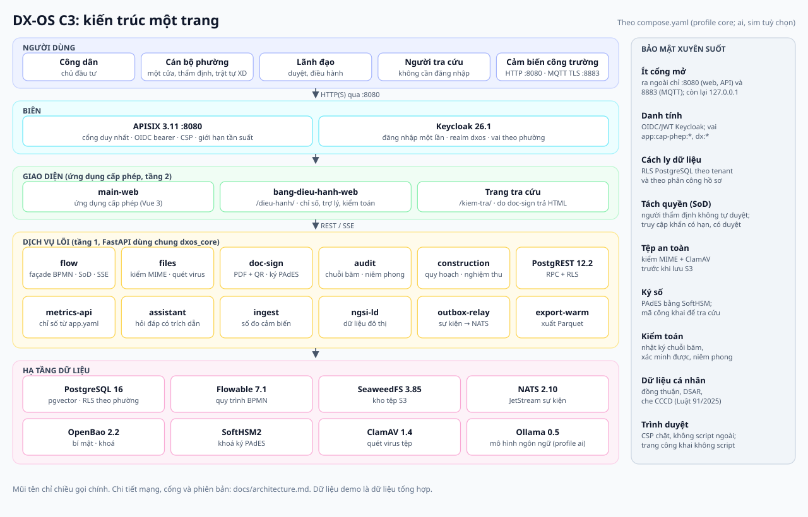

<!--
SPDX-FileCopyrightText: 2026 DX-OS Open-Core contributors
SPDX-License-Identifier: CC-BY-4.0
-->

# Kiến trúc một trang

Sơ đồ dùng cho slide 3 và cảnh 2 của [demo-script.md](demo-script.md). Bản đầy đủ (mạng, cổng, phiên bản, luồng dữ liệu) nằm ở [architecture.md](architecture.md).

## Đọc sơ đồ từ trên xuống

1. **Người dùng.** Công dân, cán bộ phường, lãnh đạo dùng trình duyệt. Người tra cứu giấy phép không cần tài khoản. Cảm biến công trường gửi số đo qua HTTP (`sensor-sim`, profile `sim`); cổng MQTT TLS `8883` của NATS dành cho thiết bị thật.
2. **Biên.** Mọi yêu cầu web và API đi qua **APISIX** ở cổng `8080`. APISIX kiểm token OIDC, đặt CSP, giới hạn tần suất. **Keycloak** cấp đăng nhập một lần và vai theo phường.
3. **Giao diện (tầng 2).**
   - Ứng dụng cấp phép (`main-web`).
   - Bảng điều hành lãnh đạo (`bang-dieu-hanh-web`, đường dẫn `/dieu-hanh/`).
   - Trang tra cứu công khai `/kiem-tra/`, do `doc-sign` trả HTML không script.
4. **Dịch vụ lõi (tầng 1).** Các dịch vụ FastAPI mỏng dùng chung thư viện `services/dxos_core` và không chứa từ vựng nghiệp vụ (ADR-005). `construction` là dịch vụ quy hoạch và nghiệm thu của track A. PostgREST mở RPC của ứng dụng, có RLS.
5. **Hạ tầng dữ liệu.**
   - PostgreSQL 16 có RLS theo phường.
   - Flowable chạy quy trình BPMN.
   - SeaweedFS là kho tệp S3.
   - NATS JetStream truyền sự kiện.
   - OpenBao giữ bí mật, SoftHSM2 giữ khoá ký PAdES.
   - ClamAV quét virus.
   - Ollama là mô hình ngôn ngữ chạy tại chỗ (profile `ai`). Không có Ollama thì trợ lý trả nguyên văn đoạn tri thức kèm trích dẫn.

## Bảo mật xuyên suốt

| Lớp | Cách làm | Nơi cấu hình |
|---|---|---|
| Ít cổng mở | Ra ngoài chỉ `8080` (web, API) và `8883` (MQTT TLS); các cổng quản trị bind `127.0.0.1` | `compose.yaml` |
| Danh tính | OIDC/JWT Keycloak, vai `app:cap-phep:*`, `dx:*` | `core/keycloak/`, `core/apisix/` |
| Cách ly dữ liệu | RLS theo tenant và theo phân công hồ sơ | `apps/cap-phep/db/migrations/` |
| Tách quyền | Người thẩm định không tự duyệt; truy cập khẩn có thời hạn, cần lãnh đạo duyệt | `services/flow`, RPC `xin_truy_cap_khan` |
| Tệp an toàn | Kiểm MIME và quét ClamAV trước khi lưu S3 | `services/files` |
| Ký số | PAdES bằng khoá trong SoftHSM2; mã công khai để tra cứu | `services/doc-sign` |
| Kiểm toán | Nhật ký chuỗi băm, xác minh và niêm phong | `services/audit` |
| Dữ liệu cá nhân | Đồng thuận, yêu cầu của chủ thể dữ liệu (DSAR), che CCCD (Luật 91/2025/QH15) | `docs/privacy.md` |
| Trình duyệt | CSP chặt, không tải script ngoài; trang công khai không có script | `core/apisix/apisix.template.yaml` |

## Đối chiếu với compose

Sơ đồ chỉ vẽ dịch vụ có trong `compose.yaml`:

- **Profile `core`:** `apisix`, `keycloak`, `main-web`, `bang-dieu-hanh-web`, `flow`, `files`, `doc-sign`, `audit`, `construction`, `postgrest`, `metrics-api`, `assistant`, `ingest`, `ngsi-ld`, `outbox-relay`, `export-warm`, `postgres`, `flowable`, `seaweedfs`, `nats`, `openbao`, `softhsm-init` (SoftHSM2), `clamav`.
- **Profile `ai`:** `ollama`.
- **Profile `sim`:** `sensor-sim`.

Container `tools` (profile `tools`, `gitops`) chỉ chạy lệnh vận hành nên không vẽ. Sơ đồ chi tiết ở `architecture.md` chưa có `construction`; sơ đồ này đã thêm theo compose hiện tại.

Sửa sơ đồ: chỉnh `docs/images/architecture.svg` (SVG thuần, mở được bằng trình duyệt hoặc Inkscape), giữ nguyên bốn lớp và cột bảo mật.
