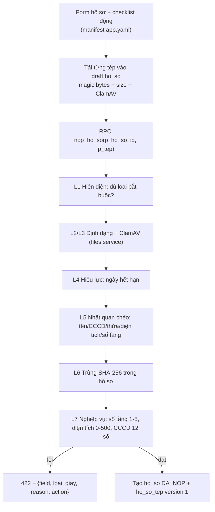
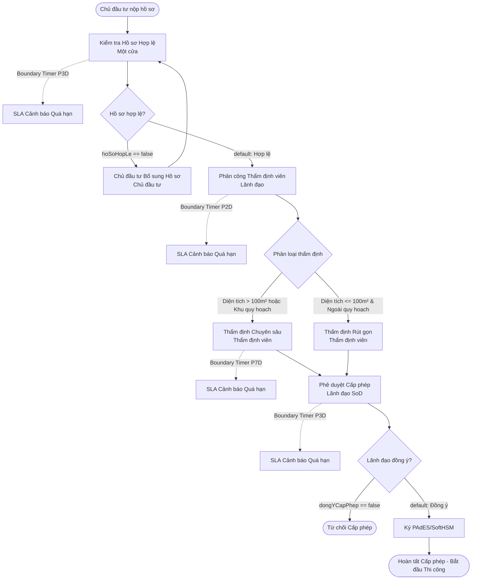

<!--
SPDX-FileCopyrightText: 2026 DX-OS Open-Core contributors
SPDX-License-Identifier: CC-BY-4.0
-->

# Tài Liệu Kiến Trúc Hệ Thống (Architecture Design)

Hệ điều hành Chuyển đổi số **DX-OS Open-Core (v5)** được thiết kế theo mô hình phân tầng hướng dịch vụ lõi (Headless PaaS Core), phân định ranh giới trách nhiệm tuyệt đối giữa hạ tầng chuyển đổi số dùng chung (Tầng 1) và các nghiệp vụ ứng dụng cắm-rút (Tầng 2).

---

## 1. Sơ Đồ Kiến Trúc Tổng Thể

```mermaid
flowchart TD
    subgraph ClientLayer ["Lớp Khách & Ngoại vi"]
        UserBrowser["Trình duyệt Người dùng<br/>(SPA Web Clients)"]
        PublicUser["Công dân tra cứu công khai<br/>/kiem-tra/{code}"]
        IoTField["Cảm biến IoT công trường<br/>(MQTT TLS :8883)"]
    end

    subgraph EdgeNetwork ["Biên Mạng (Edge Network - Mạng Docker: edge)"]
        APISIXGateway["Apache APISIX Gateway (:8080)<br/>- OIDC JWT Authentication & JWKS<br/>- Rate Limiting: 120 req/min/IP<br/>- CSP & Security Headers<br/>- Prometheus Exporter Plugin"]
    end

    subgraph AppNetwork ["Tầng Dịch Vụ Mỏng (App Network - Mạng Docker: app)"]
        subgraph WebApps ["Ứng dụng Giao diện Web (Tầng 2)"]
            CapPhepWeb["cap-phep-web<br/>(Không gian H & P)"]
            BangDieuHanhWeb["bang-dieu-hanh-web<br/>(Không gian D & I)"]
        end

        subgraph CoreServices ["Dịch vụ Mỏng DX-OS (FastAPI / Python 3.12)"]
            SvcFiles["files<br/>- Quét ClamAV<br/>- Ký URL truy cập S3"]
            SvcDocSign["doc-sign<br/>- Sinh PDF kèm QR<br/>- Ký PAdES qua SoftHSM/PKCS#11"]
            SvcFlow["flow<br/>- Façade BPMN<br/>- SoD Enforcer<br/>- SSE Event Stream"]
            SvcIngest["ingest<br/>- Lọc & Chuẩn hóa IoT<br/>- Cảnh báo ngưỡng QCVN"]
            SvcNgsiLd["ngsi-ld<br/>- Thực thể đô thị NGSI-LD"]
            SvcAudit["audit<br/>- Verify chuỗi băm<br/>- Niêm phong WORM"]
            SvcMetrics["metrics-api<br/>- DuckDB Lakehouse<br/>- OpenLineage Events"]
            SvcWarm["export-warm<br/>- Snapshot Parquet"]
            SvcOutbox["outbox-relay<br/>- Transactional Outbox"]
            SvcAssistant["assistant (Profile ai)<br/>- RAG tri thức qua PostgREST"]
        end
    end

    subgraph DataNetwork ["Tầng Dữ Liệu & Hạ Tầng Lõi (Data Network - Mạng Docker: data)"]
        PostgresDB[("PostgreSQL 16 + pgvector<br/>- Schema core (Audit, Files, Outbox, Lineage)<br/>- Schema app_cap_phep (Nghiệp vụ)<br/>- Row Level Security (RLS)")]
        PostgRESTAPI["PostgREST 12.x<br/>- API tự sinh theo RLS"]
        FlowableEngine["Flowable REST 7.x<br/>- Động cơ quy trình BPMN"]
        NATSServer["NATS Server 2.10<br/>- JetStream Stream DX_EVENTS<br/>- MQTT Gateway TLS :8883"]
        SeaweedStorage["SeaweedFS S3<br/>- Bucket: staging, files, lake, worm"]
        OpenBaoKMS["OpenBao 2.2<br/>- Secrets/Transit legacy"]
        SoftHSMToken["SoftHSM2 2.6<br/>- PKCS#11 token + test CA"]
        ClamAVDaemon["ClamAV 1.4<br/>- Quét mã độc INSTREAM"]
        KeycloakSSO["Keycloak 26.1<br/>- Realm dxos, OIDC PKCE"]
    end

    UserBrowser -->|HTTPS :8080| APISIXGateway
    PublicUser -->|HTTPS :8080| APISIXGateway
    IoTField -->|MQTT TLS :8883| NATSServer

    APISIXGateway --> CapPhepWeb
    APISIXGateway --> BangDieuHanhWeb
    APISIXGateway --> PostgRESTAPI
    APISIXGateway --> SvcFiles
    APISIXGateway --> SvcDocSign
    APISIXGateway --> SvcFlow
    APISIXGateway --> SvcIngest
    APISIXGateway --> SvcNgsiLd
    APISIXGateway --> SvcAudit
    APISIXGateway --> SvcMetrics
    APISIXGateway --> SvcAssistant
    APISIXGateway --> KeycloakSSO

    SvcFiles --> ClamAVDaemon
    SvcFiles --> SeaweedStorage
    SvcFiles --> PostgresDB

    SvcDocSign --> SoftHSMToken
    SvcDocSign -.->|legacy| OpenBaoKMS
    SvcDocSign --> SeaweedStorage
    SvcDocSign --> PostgresDB

    SvcFlow --> FlowableEngine
    SvcFlow --> PostgresDB
    SvcFlow --> NATSServer

    SvcIngest --> PostgresDB
    SvcIngest --> NATSServer

    SvcOutbox --> PostgresDB
    SvcOutbox --> NATSServer

    SvcAudit --> PostgresDB
    SvcAudit --> SeaweedStorage

    SvcWarm --> PostgresDB
    SvcWarm --> SeaweedStorage

    SvcMetrics --> SeaweedStorage
    SvcMetrics --> PostgresDB

    SvcAssistant --> APISIXGateway
    PostgRESTAPI --> PostgresDB
    FlowableEngine --> PostgresDB
```

---

## 2. Phân Vùng Mạng (Network Segmentation)

Hệ thống được cô lập bằng 3 mạng nội bộ Docker:

| Tên Mạng | Mục Đích | Thành Phần Tham Gia | Ràng Buộc Bảo Mật |
| :--- | :--- | :--- | :--- |
| **`edge`** | Kết nối ngoại vi và định tuyến cổng vào | `apisix`, `cap-phep-web`, `bang-dieu-hanh-web`, `doc-sign` (public) | Chỉ mở cổng `8080` (HTTP/HTTPS) và `8883` (MQTT TLS). |
| **`app`** | Giao tiếp giữa APISIX và các microservices | `apisix`, `files`, `doc-sign`, `flow`, `ingest`, `ngsi-ld`, `audit`, `metrics-api`, `assistant`, `postgrest` | Không thể truy cập trực tiếp từ Internet. |
| **`data`** | Hạ tầng lưu trữ và dữ liệu nhạy cảm | `postgres`, `seaweedfs`, `openbao`, `clamav`, `flowable`, `nats`, toàn bộ dịch vụ mỏng | **Tuyệt đối không nối vào mạng `edge`**. Không bind cổng công khai. |

---

## 3. Cổng Dịch Vụ và Ranh Giới Lắng Nghe

| Cổng | Giao Thức | Dịch Vụ | Phạm Vi Bind | Mục Đích |
| :--- | :--- | :--- | :--- | :--- |
| `8080` | HTTP/HTTPS | `apisix` | `0.0.0.0` (Công khai) | Lối vào duy nhất cho toàn bộ giao diện và REST API |
| `8883` | MQTT / TLS | `nats` | `0.0.0.0` (Công khai khi bật profile sim/thiết bị) | Tiếp nhận luồng cảm biến IoT công trường |
| `8081` | HTTP | `keycloak` | `127.0.0.1` (Cục bộ quản trị) | Giao diện quản trị Keycloak Admin Console |
| `8082` | HTTP | `flowable` | `127.0.0.1` (Cục bộ nội bộ) | Flowable Task/Process Engine Admin |
| `8333` | HTTP | `seaweedfs` | `127.0.0.1` (Cục bộ nội bộ) | SeaweedFS S3 Management / Filer |
| `8200` | HTTP | `openbao` | `127.0.0.1` (Cục bộ nội bộ) | Khởi tạo Unseal OpenBao KMS |
| `5432` | TCP | `postgres` | `127.0.0.1` (Cục bộ nhà phát triển) | Truy cập cơ sở dữ liệu khi phát triển & gỡ lỗi |
| `9090` | HTTP | `prometheus`| `127.0.0.1` (Cục bộ nội bộ) | Giám sát số liệu hạ tầng |
| `3000` | HTTP | `grafana` | `127.0.0.1` (Cục bộ nội bộ) | Bảng điều khiển giám sát vận hành |

---

## 4. Dòng Chảy Dữ Liệu (Data Flow)

### 4.1 Quy trình Nộp tệp và Kiểm dịch ClamAV (Quarantine Flow)
1. Trình duyệt gửi `multipart/form-data` lên APISIX `/api/v1/files`.
2. APISIX xác thực JWT Bearer, chuyển tiếp sang dịch vụ `files`.
3. Dịch vụ `files` kiểm tra MIME type, magic bytes và kích thước (`<= 20MB`).
4. Ghi tạm vào `staging/<tenant>/<uuid>` trên SeaweedFS.
5. Gửi luồng byte qua kết nối TCP tới ClamAV daemon (`INSTREAM`, timeout 30s).
   - Nếu phát hiện chữ ký độc hại (EICAR): di chuyển sang vùng cách ly `staging/quarantine/`, ghi nhật ký kiểm toán vi phạm `file.infected`, trả về mã lỗi `422 Unprocessable Entity`.
   - Nếu ClamAV không phản hồi / quá thời gian: xóa tệp tạm, ghi `file.scan_failed`, trả về `503 Service Unavailable` kèm tiêu đề `Retry-After`.
   - Nếu an toàn: chuyển tệp sang bucket chính `files/<tenant>/<năm>/<uuid>`, ghi bản ghi vào bảng `core.files` và đồng thời tạo sự kiện outbox trong cùng một transaction.

### 4.1b Quy trình Nộp hồ sơ & 7 lớp kiểm tra giấy tờ (P1)

- Manifest lưu ở `app_cap_phep.document_requirements`, seed từ `app.yaml` khi `app-install`.
- Không tin UI: mọi kiểm tra chạy lại trong PostgreSQL (`SECURITY DEFINER`), fail-closed.
- Bổ sung hồ sơ: `dinh_kem_tep` tự tăng `version`, giữ `tep_goc_id`, chống trùng SHA-256.
- Cán bộ đánh giá từng tệp qua `danh_gia_tep` (`dat` / `khong_dat` + lý do), ghi audit.

### 4.2 Quy trình Cấp phép và Ký số PAdES/SoftHSM
1. Lãnh đạo phê duyệt hồ sơ trên giao diện cán bộ.
2. Dịch vụ `flow` kiểm tra quy tắc loại trừ SoD (`dx:sodExclude`), gọi dịch vụ `doc-sign`.
3. Dịch vụ `doc-sign` nạp template HTML của app, điền dữ liệu hồ sơ, kết xuất PDF.
4. Sinh mã định danh công khai ngắn (`public_code`), tạo mã QR chứa đường dẫn `PUBLIC_BASE_URL/kiem-tra/<public_code>` gắn vào chân trang giấy phép.
5. Ký PDF bằng PAdES (`ETSI.CAdES.detached`) qua `pyHanko` + `python-pkcs11`; private key nằm trong token SoftHSM2/PKCS#11.
6. Lưu trữ tệp PDF đã ký vào SeaweedFS, ghi nhận thông tin chữ ký vào bảng `core.signed_docs` và trả kết quả về quy trình.

### 4.3 Quy trình BPMN Cấp phép Xây dựng (BPMN Flow with Gateways & Timers)

### Cơ chế xử lý quá hạn SLA và Boundary Timer (P-04, Q-01)

Hệ thống sử dụng cơ chế Non-interrupting Boundary Timer (`cancelActivity="false"`) gắn tại từng nhiệm vụ trong quy trình BPMN Flowable:
1. **Thiết lập hạn bước động (`han_buoc_at`)**: Khi bắt đầu quy trình hoặc hoàn thành từng nhiệm vụ, facade service `flow` tính toán thời hạn bước tiếp theo dựa trên cấu hình `flow_policies.sla` trong `app.yaml` (hoặc biến môi trường thử nghiệm) và lưu vào biến quy trình `${han_buoc_at}` định dạng ISO-8601.
2. **Kích hoạt Hook Quá hạn qua Flowable Service Task (HTTP nội bộ) (Q-01)**: Khi đến thời điểm `${han_buoc_at}`, Flowable async job executor kích hoạt boundary timer event. Luồng timer dẫn tới một Service Task dạng `flowable:type="http"` thực hiện gọi `POST http://flow:8000/internal/timer` (đường dẫn nội bộ, không định tuyến qua gateway APISIX) kèm header `X-DXOS-Internal-Token` lấy trực tiếp từ biến môi trường `${systemEnvironment['FLOW_INTERNAL_TOKEN']}` của container Flowable, cùng `process_instance_id` và `task_def`. Dịch vụ `flow` đối chiếu `process_instance_id` với Flowable REST để bảo đảm quy trình tồn tại, chưa kết thúc và đúng tenant trước khi gọi hàm hook SQL.
3. **Thực thi Hook và Ghi nhận Kiểm toán**: Dịch vụ `flow` tiếp nhận sự kiện và gọi hàm hook SQL đăng ký trong `flow_policies.on_timer` (`app_cap_phep_private.ghi_qua_han(p_process_id, p_task_def, p_tenant)`). Hàm này lọc chính xác theo tenant của hồ sơ, cập nhật cờ `qua_han = true` và phát sinh bản ghi kiểm toán `sla.qua_han` trong `core.audit_log`. Nhiệm vụ ban đầu vẫn duy trì mở để cán bộ tiếp tục xử lý theo thẩm quyền.
