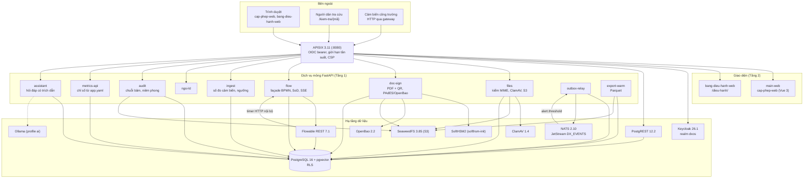
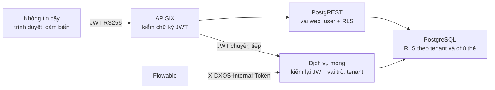
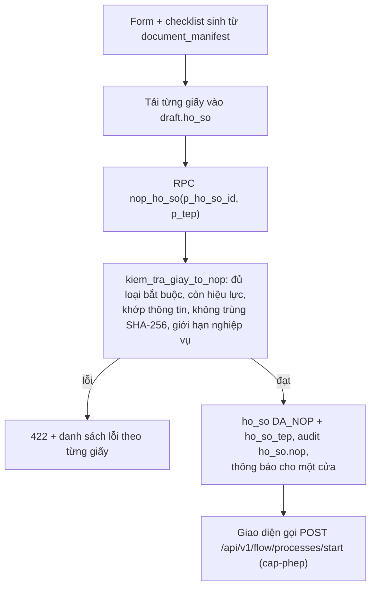
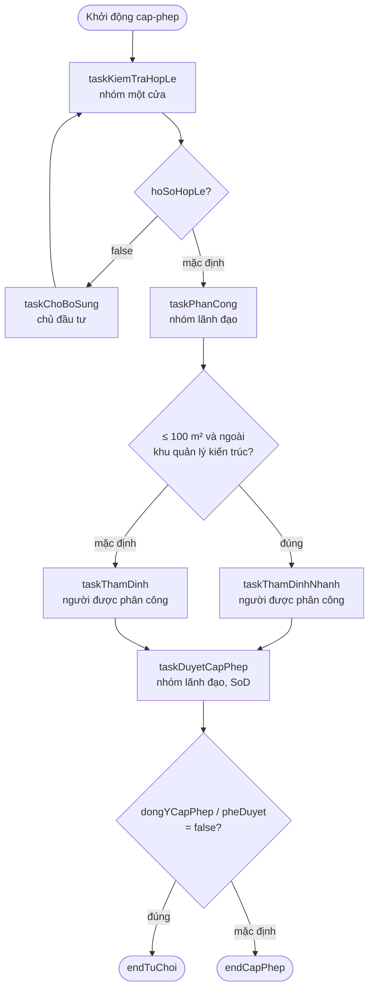

<!--
SPDX-FileCopyrightText: 2026 DX-OS Open-Core contributors
SPDX-License-Identifier: CC-BY-4.0
-->

# Kiến trúc hệ thống

DX-OS Open-Core chia làm hai tầng. Tầng 1 là các dịch vụ lõi dùng chung, không chứa nghiệp vụ.
Tầng 2 là gói ứng dụng cắm vào lõi qua hợp đồng `app.yaml`; gói mẫu là `apps/cap-phep`
(một cửa cấp phép xây dựng và hậu kiểm công trường). Hợp đồng gói ứng dụng mô tả ở
[app-package.md](app-package.md); lý do của từng lựa chọn ghi ở [DECISIONS.md](DECISIONS.md).

Mọi số liệu trong tài liệu này (cổng, phiên bản, tên mạng) lấy từ `compose.yaml` và
`core/apisix/apisix.template.yaml` của nhánh hiện tại.

## 1. Sơ đồ thành phần

Các dịch vụ mỏng dùng chung thư viện `services/dxos_core` (xác thực JWT, kết nối CSDL, S3,
ClamAV, OpenBao, ghi audit, outbox, lineage) và cùng một image `dxos/services`.

## 2. Profile Compose

| Profile | Thành phần |
| :--- | :--- |
| `core` | toàn bộ hạ tầng dữ liệu, dịch vụ mỏng, `assistant`, `softhsm-init`, hai giao diện web, `apisix` |
| `ai` | `ollama` (và `assistant`, vốn đã có trong `core`) |
| `sim` | `sensor-sim` gửi số đo giả lập qua MQTT |
| `tools`, `gitops` | container `tools` chạy script vận hành (`dx`, reconciler, sao lưu) |

`assistant` chạy được không cần Ollama: khi Ollama không phản hồi, dịch vụ trả nguyên văn đoạn
tri thức liên quan nhất kèm trích dẫn thay vì sinh câu trả lời.

## 3. Phân vùng mạng

| Mạng | Thành phần |
| :--- | :--- |
| `edge` (`dxos-edge`) | `apisix`, `main-web`, `bang-dieu-hanh-web`, `keycloak`, `doc-sign`, `tools` |
| `app` (`dxos-app`) | `apisix`, các dịch vụ mỏng, `postgrest`, `flowable`, `keycloak`, `nats`, giao diện web |
| `data` (`dxos-data`) | `postgres`, `seaweedfs`, `clamav`, `openbao`, `nats`, `flowable`, `keycloak`, `postgrest`, các dịch vụ mỏng, `ollama` |

`postgres`, `seaweedfs`, `clamav`, `openbao`, `softhsm-init` và `ollama` chỉ ở mạng `data`. `keycloak`, `doc-sign` và `tools` nối cả `edge`
và `data`; đây là các điểm cần chú ý khi rà soát an ninh mạng.

## 4. Cổng mở ra máy chủ

| Cổng máy chủ | Dịch vụ | Bind | Ghi chú |
| :--- | :--- | :--- | :--- |
| `8080` | `apisix` | mọi địa chỉ | lối vào duy nhất cho giao diện và API |
| `8883` | `nats` | mọi địa chỉ | cổng MQTT TLS của NATS (xem 6.5) |
| `8081` | `keycloak` | `127.0.0.1` | quản trị Keycloak |
| `8082` | `flowable` | `127.0.0.1` | Flowable REST (quản trị, test) |
| `8333` | `seaweedfs` | `127.0.0.1` | S3 |
| `8200` | `openbao` | `127.0.0.1` | khởi tạo, mở khóa |
| `4222` | `nats` | `127.0.0.1` | NATS client |

PostgreSQL không mở cổng ra máy chủ; script và test truy cập qua `docker exec dxos-postgres psql`
hoặc qua container `tools`.

## 5. Ranh giới tin cậy

1. **Gateway.** Các route `/api/v1/rest/*`, `/api/v1/files*`, `/api/v1/docs*`, `/api/v1/flow*`,
   `/api/v1/ngsi-ld*`, `/api/v1/ingest*`, `/api/v1/metrics*`, `/api/v1/audit*`,
   `/api/v1/assistant*` bật plugin `openid-connect` ở chế độ `bearer_only` với JWKS của Keycloak:
   thiếu token hoặc token sai chữ ký bị trả 401 ngay tại gateway. Mỗi route có `limit-count`
   120 yêu cầu/phút/IP (trang `/kiem-tra/*` là 30).
2. **Route công khai.** `/kiem-tra/*` (tra cứu văn bản đã ký), `/api/v1/rest/cong_khai_*`,
   `/api/v1/health`, `/auth/realms/dxos/*`, `/auth/resources/*` không cần token.
   `/api/v1/events*` (SSE) không qua OIDC vì `EventSource` không gửi được header; trình duyệt lấy
   vé dùng một lần ở `POST /api/v1/events/ticket` (có JWT) rồi mở luồng bằng vé.
3. **Dịch vụ.** Dịch vụ kiểm lại JWT bằng JWKS (`dxos_core.jwt`), lấy `tenant` và `sub` từ token,
   không nhận tenant từ thân yêu cầu.
4. **CSDL.** PostgREST đổi sang vai `web_user`; chính sách RLS lọc theo `core.jwt_tenant()`,
   `core.jwt_sub()`, `core.has_role()`. Dịch vụ nền dùng vai `dxos_svc`, không có quyền
   superuser, `CREATEROLE`, `CREATEDB` hay `BYPASSRLS` (kiểm bởi `test_V3_02`).
5. **Gọi ngược nội bộ.** Timer của Flowable gọi `POST http://flow:8000/internal/timer` trong mạng
   nội bộ, kèm `X-DXOS-Internal-Token` (biến `FLOW_INTERNAL_TOKEN`); đường này không đi qua APISIX.
6. **Trang công khai.** `/kiem-tra/{mã}` chỉ trả mã tra cứu, loại văn bản, đơn vị, ngày ký, thuật
   toán và mã băm; không trả dữ liệu cá nhân và không cho tải bản gốc. CSP của route:
   `default-src 'none'`, `form-action 'self'` (cho biểu mẫu đối soát tệp), `frame-ancestors 'none'`.

## 6. Luồng dữ liệu

### 6.1 Tải tệp và kiểm dịch

1. Trình duyệt gửi `multipart/form-data` tới `POST /api/v1/files` với `object_type`, `object_id`.
2. `files` kiểm kích thước (tối đa 20 MB), phần mở rộng và magic bytes.
3. Với đối tượng có sẵn, gọi `core.can_access(object_type, object_id, 'write')`; không có quyền thì
   trả 403 và ghi audit `access.denied`. Tiền tố `draft.` cho phép tải tệp trước khi tạo hồ sơ.
4. Ghi tạm vào bucket `staging`, quét bằng ClamAV `INSTREAM` (timeout 30 giây).
   - Có mã độc: chuyển sang `staging/quarantine/<tenant>/...`, ghi audit `file.infected`, trả 422.
   - ClamAV lỗi hoặc quá hạn: xóa tệp tạm, trả 503 kèm `Retry-After`.
   - Sạch: chép sang bucket `files/<tenant>/<năm>/<uuid>.<đuôi>`, ghi `core.files`, audit
     `file.uploaded` và sự kiện outbox `file.uploaded`.

### 6.2 Nộp hồ sơ và kiểm tra giấy tờ

Danh mục giấy tờ khai báo ở khóa `document_manifest` của `app.yaml`, được nạp vào
`app_cap_phep.document_requirements` khi cài app. Mọi kiểm tra chạy lại trong PostgreSQL,
không tin kết quả kiểm tra của giao diện.

### 6.3 Quy trình cấp phép

- **Hoàn thành việc** đi qua `POST /api/v1/flow/tasks/{id}/complete`. `flow` kiểm tenant của việc,
  người gọi là người được giao hoặc thuộc nhóm ứng viên, biến được phép theo
  `flow_policies.task_variables` và vai được đặt biến theo `flow_policies.variable_roles`.
- **SoD.** `flow_policies.sod_rules.taskDuyetCapPhep.exclude_variable = nguoiThamDinh`: người
  thẩm định không được tự phê duyệt; vi phạm bị trả 403 và ghi audit `sod.violation_prevented`.
- **Ký số khi phê duyệt.** `flow_policies.on_task_complete.taskDuyetCapPhep` (khi
  `dongYCapPhep = true`) chạy `guard_sql`, lấy dữ liệu bằng `data_sql`, gọi `doc-sign` ký văn bản
  `giay-phep-xay-dung`, rồi `after_sql` (`app_cap_phep_private.cap_giay_phep`) tạo giấy phép số
  `GPXD-<tenant>-<năm>-<số thứ tự>`, công trình `CT-...` và chuyển hồ sơ sang `DA_CAP`.
- **Hạn xử lý.** `flow` tính `han_buoc_at` theo `flow_policies.sla` (P3D, P2D, P7D, P5D, P3D) và
  đặt vào biến quy trình. Mỗi việc có timer biên không ngắt việc (`timeDate = han_buoc_at`); khi
  đến hạn, service task HTTP gọi `/internal/timer`, `flow` đối chiếu quy trình với Flowable rồi
  gọi `flow_policies.on_timer` (`app_cap_phep_private.ghi_qua_han`) để đặt `qua_han` và ghi audit.
- **Thông báo.** Khi khởi động quy trình hoặc hoàn thành việc, `flow` đẩy sự kiện SSE
  `notification` tới các phiên cùng tenant; người không phải cán bộ chỉ nhận sự kiện của hồ sơ
  của mình.

### 6.4 Ký văn bản và xác minh công khai

1. `doc-sign` nhận `POST /api/v1/docs/sign` (vai ký lấy từ `doc_signers` trong `app.yaml`),
   sinh mã tra cứu `DOC-<128 bit ngẫu nhiên>`, tạo PDF có mã QR dẫn tới
   `PUBLIC_BASE_URL/kiem-tra/<mã>`.
2. `SIGNING_MODE=pkcs11` (mặc định): ký PAdES bằng pyHanko qua PKCS#11, khóa nằm trong token
   SoftHSM2 do `softhsm-init` tạo kèm CA thử nghiệm. `SIGNING_MODE=openbao`: ký Ed25519 bằng
   OpenBao Transit (giữ cho văn bản cũ).
3. PDF lưu ở bucket `files`, bản ghi ở `core.signed_docs`, audit `doc.signed`.
4. Người dân mở `/kiem-tra/<mã>` để xem trạng thái `Hợp lệ` hoặc `Đã thu hồi`, và gửi tệp PDF
   đang giữ tới `/kiem-tra/<mã>/verify-file` để đối soát mã băm và chữ ký.
5. Bản gốc chỉ tải được qua `GET /api/v1/docs/{id}/download` có JWT: người ký, quản trị, hoặc
   người có quyền đọc đối tượng gắn với văn bản (`core.can_access`). Thu hồi qua
   `POST /api/v1/docs/{id}/revoke`.

### 6.5 Cảm biến và hậu kiểm

1. Cảm biến (hoặc `sensor-sim`) gọi `POST /api/v1/ingest` bằng token `client_credentials` của
   client `dxos-sensor-<tenant>` (vai `dx:device`). Tenant trong thân yêu cầu khác tenant của token
   bị trả 403 và ghi audit `ingest.tenant_mismatch`. NATS có mở cổng MQTT TLS 8883 nhưng hiện chưa
   có dịch vụ nào đọc số đo từ MQTT; đường vào số đo duy nhất là HTTP.
2. `ingest` ghi `core.timeseries` và cập nhật `core.entity_state` với
   `entity_id = urn:ngsi-ld:Site:<mã công trình>`.
3. Ngưỡng đọc từ tệp quy tắc của app (`apps/cap-phep/rules/nguong.yaml`): tiếng ồn 70 dBA ban
   ngày (6–21 giờ), 55 dBA ban đêm; bụi PM10 100 µg/m³. Vượt ngưỡng thì ghi outbox
   `alert.threshold` và lineage `iot_ingest`.
4. `outbox-relay` đẩy outbox lên JetStream `DX_EVENTS` với subject `dxos.<tenant>.<topic>` và tự
   nhận lại `dxos.*.alert.threshold`: gọi `alert_hooks.hau-kiem.on_alert`
   (`app_cap_phep_private.tao_phieu_kiem_tra`) để lập phiếu, khởi động quy trình `hau-kiem`, rồi
   gọi `on_process_started` để gắn quy trình vào phiếu.
   Một đợt vượt ngưỡng chỉ tạo một phiếu (kiểm bởi `test_Z06`, `test_N04`).

### 6.6 Chỉ số và trợ lý

- `metrics-api` đọc danh sách chỉ số từ `core.app_policies` (khóa `metrics` của `app.yaml`, theo
  `thu_tu`), mỗi chỉ số chạy trong savepoint riêng và chỉ trả số tổng hợp; phả hệ ở
  `GET /api/v1/metrics/{code}/lineage`.
- `export-warm` xuất chuỗi thời gian theo tháng ra Parquet ở
  `s3://lake/core/timeseries/tenant=<tenant>/thang=<YYYY-MM>/`.
- `assistant` tìm đoạn tri thức của đúng tenant trong `core.knowledge_chunks` theo từ khóa, trả lời
  kèm trích dẫn; không có căn cứ thì trả lời là không tìm thấy.

### 6.7 Kiểm toán

`core.record_audit` ghi `core.audit_log` theo chuỗi băm; vai ứng dụng không có quyền sửa, xóa
hay ghi thẳng bảng này. `audit` kiểm chuỗi (`GET /api/v1/audit/verify`) và niêm phong đầu chuỗi
vào `core.audit_seal` cùng bucket `worm` (`POST /api/v1/audit/seal`).
