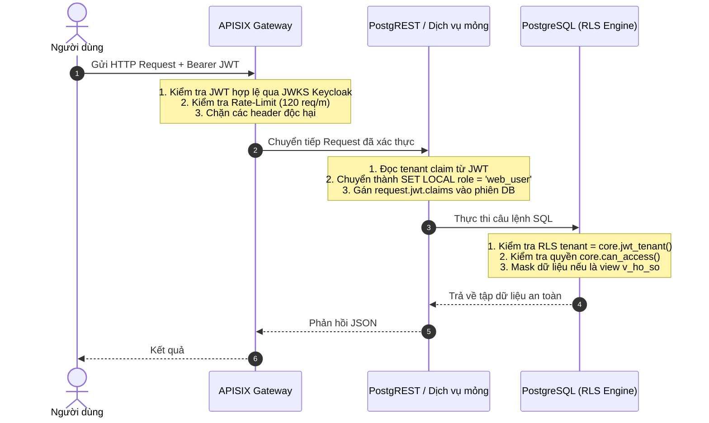

<!--
SPDX-FileCopyrightText: 2026 DX-OS Open-Core contributors
SPDX-License-Identifier: CC-BY-4.0
-->

# Kiến Trúc An Toàn Thông Tin & Bốn Khoảnh Khắc Bảo Mật (Security Architecture)

Hệ thống **DX-OS Open-Core (v5)** áp dụng nguyên lý **Zero-Trust** kết hợp mô hình phòng thủ theo chiều sâu (Defense-in-Depth). Không có bất kỳ thành phần nào trong mạng nội bộ được tin cậy mặc định.

---

## 1. Bốn Khoảnh Khắc Bảo Mật Then Chốt (4 Security Moments)

### Khoảnh khắc 1: Kiểm dịch tệp tại cửa ngõ (Quarantine at the Gate)
- **Vấn đề:** Các tệp đính kèm do người nộp hồ sơ tải lên có nguy cơ chứa mã độc, virus tống tiền hoặc macro độc hại.
- **Giải pháp:** 100% tệp tin khi tải lên `/api/v1/files` đều được đưa vào vùng cách ly tạm thời (`staging/<tenant>/<uuid>`). Dịch vụ `files` kích hoạt quét luồng byte trực tiếp tới ClamAV qua giao thức TCP socket (`INSTREAM`).
- **Xử lý vi phạm:** Nếu phát hiện chữ ký độc hại (như tệp thử nghiệm EICAR):
  - Tệp lập tức bị di chuyển vào vùng kiểm dịch riêng `staging/quarantine/`.
  - Ghi nhận vi phạm an toàn vào bảng `core.audit_log` với hành động `file.infected`.
  - Trả về mã lỗi HTTP `422 Unprocessable Entity` với thông báo tiếng Việt: `{"loi": "Tệp chứa mã độc"}`.
  - Tệp hoàn toàn không bao giờ xuất hiện trong kho lưu trữ chính thức của hệ thống.

### Khoảnh khắc 2: Từ chối có lưu vết & Truy cập Khẩn cấp (Audited 403 & Break-Glass)
- **Vấn đề:** Cán bộ công quyền có thể tò mò mở hồ sơ của người quen hoặc công trình không thuộc phạm vi được giao.
- **Giải pháp:** Khi cán bộ gọi API mở hồ sơ `app_cap_phep.mo_ho_so(id)`:
  - Hệ thống kiểm tra hàm phân quyền đối tượng `core.can_access('ho_so', id)`.
  - Nếu không có phân công hiệu lực và không có phê duyệt truy cập khẩn cấp: hàm **không `RAISE EXCEPTION`** (để tránh rollback giao dịch), mà ghi ngay một bản ghi kiểm toán `core.audit_log` với hành động `access.denied`, đặt `response.status = 403` và trả JSON thông báo lỗi.
- **Cơ chế Truy cập Khẩn cấp (Break-Glass):**
  - Cán bộ bị từ chối có thể bấm nút "Xin truy cập khẩn cấp" và nêu rõ lý do chính đáng.
  - Yêu cầu được gửi lên Lãnh đạo phê duyệt qua quy trình BPMN `truy-cap-khan`.
  - Khi được duyệt, bảng `core.break_glass` ghi nhận quyền truy cập tạm thời kèm thời hạn hiệu lực (`expires_at = now() + BREAK_GLASS_TTL`).
  - Hết thời gian này (mặc định 2 giờ, hoặc 5 giây trong kịch bản test), quyền truy cập tự động bị vô hiệu hóa.

### Khoảnh khắc 3: Phân tách nhiệm vụ tuyệt đối (Separation of Duties - SoD)
- **Vấn đề:** Nguy cơ tiêu cực khi người trực tiếp thẩm định lại có thể tự mình phê duyệt cấp phép.
- **Giải pháp:**
  - Định nghĩa quy trình BPMN sử dụng thuộc tính mở rộng `dx:sodExclude=<tenBien>` (ví dụ: `dx:sodExclude=nguoiThamDinh`).
  - Tại dịch vụ mỏng `flow`, khi nhận yêu cầu hoàn thành nhiệm vụ phê duyệt, hệ thống đối soát `jwt.sub` của người gọi với giá trị biến quy trình `nguoiThamDinh`.
  - Nếu trùng khớp, yêu cầu bị từ chối lập tức với mã lỗi `403 Forbidden`.
  - Trên giao diện cán bộ, nút "Phê duyệt" tự động ẩn đối với người đã thực hiện bước thẩm định.

### Khoảnh khắc 4: Chuỗi băm kiểm toán bất biến & Niêm phong WORM (Tamper-Evident Audit Chain)
- **Vấn đề:** Nguy cơ quản trị viên hệ thống hoặc kẻ tấn công có quyền DB xóa hoặc chỉnh sửa dữ liệu để phi tang dấu vết.
- **Giải pháp:**
  - Mọi thao tác INSERT/UPDATE/DELETE trên các bảng nhạy cảm đều kích hoạt trigger ghi vào bảng `core.audit_log` **trong cùng một giao dịch**.
  - Mã băm của mỗi bản ghi được tính toán bằng mật mã học:  
    `hash = sha256(prev_hash || canonical_json(current_row))`
  - Sử dụng khóa giao dịch mức cao `pg_advisory_xact_lock(tenant_id)` để đảm bảo tính tuần tự tuyệt đối trong từng tenant.
  - Bảng `core.audit_log` chỉ cho phép quyền `INSERT`; thu hồi toàn bộ quyền `UPDATE` và `DELETE` đối với mọi vai ứng dụng.
  - Định kỳ mỗi 15 phút, dịch vụ `audit` đóng gói đỉnh chuỗi băm (head hash) và niêm phong vào bucket `worm` trên SeaweedFS và bảng `core.audit_seal`.
  - Lệnh `make verify` hoặc API `/api/v1/audit/verify` duyệt toàn bộ chuỗi băm; nếu phát hiện bất kỳ dòng nào bị sửa đổi thô, hệ thống chỉ đích danh ID của dòng vi phạm đầu tiên.

---

## 2. Xác Thực & Phân Quyền Đa Tầng

---

## 3. Chữ Ký Số PAdES/SoftHSM & Quản Lý Khóa Shamir (S-04)

- Mặc định demo dùng **PAdES** (`ETSI.CAdES.detached`) qua `pyHanko` + `python-pkcs11`, khóa riêng nằm trong token **SoftHSM2/PKCS#11**.
- **Ứng dụng không bao giờ nắm giữ khóa riêng tư:** `doc-sign` mở phiên PKCS#11, ký PDF rồi đóng phiên; private key không nằm trong source, `.env` hay filesystem.
- Test CA và leaf cert được tạo bởi `scripts/softhsm_init.sh`; đây là test CA phục vụ demo, **không có giá trị pháp lý**.
- Chế độ legacy `SIGNING_MODE=openbao` dùng OpenBao Transit Ed25519 cho tài liệu cũ.
- Trang công khai `/kiem-tra/{public_code}` kiểm tra đồng thời SHA-256 và chữ ký PAdES, cho phép tải PDF và đối soát tệp đã sửa.

### 3.1. Chính Sách Quản Trị Khóa Sản Xuất (Production Key Custody)
- Khóa gốc (Root Key) của OpenBao được phân rã theo thuật toán Shamir's Secret Sharing với sơ đồ 3-of-5 (5 mảnh khóa, ngưỡng tái tạo là 3 mảnh).
- Khi triển khai sản xuất thực tế (`DEMO_MODE=false`), 5 mảnh khóa này phải được bàn giao cho 5 người nắm giữ độc lập (5 Key Custodians) và **tuyệt đối không được lưu trữ trên cùng máy chủ** hoặc trong thư mục `secrets/` cạnh dữ liệu.
- Việc lưu `secrets/bao-unseal.json` trên máy chủ chỉ được chấp nhận ở chế độ thử nghiệm / trình diễn (`DEMO_MODE=true`). Khi bật `DEMO_MODE=true`, lệnh `dx up` sẽ in dòng cảnh báo màu vàng để báo hiệu rủi ro.

### 3.2. Quy Trình Mở Khóa Thủ Công (Manual Unseal)
- Khi máy chủ khởi động lại hoặc OpenBao bị seal trong môi trường sản xuất, hệ thống áp dụng cơ chế Fail-Closed: `dx up` sẽ dừng ngay lập tức với mã lỗi ≠ 0 và in thông báo hướng dẫn unseal thủ công.
- Tối thiểu 3 trong 5 người nắm giữ khóa phải trực tiếp nhập mảnh khóa của mình vào container OpenBao (`bao operator unseal` hoặc `./dx.ps1 bao-unseal` / `./dx.sh bao-unseal`) để kích hoạt lại hệ thống mã hóa và ký số.

---

## 4. Quản Trị Vận Hành GitOps & Rủi Ro Docker Socket (O-01)

- Container tiện ích `tools` khi chạy với profile `gitops` được gắn Docker socket `/var/run/docker.sock` nhằm phục vụ tính năng tự phục hồi cấu hình (Self-Healing Reconciler) khi phát hiện trôi dạt (drift) cấu hình `compose.yaml`.
- **Đánh giá rủi ro an ninh:** Việc gắn `/var/run/docker.sock` cấp quyền kiểm soát Docker daemon tương đương quyền `root` trên hệ điều hành máy chủ. Do đó:
  1. Profile `gitops` chỉ được kích hoạt trong môi trường vận hành nội bộ được kiểm soát nghiêm ngặt bởi đội ngũ kỹ sư hệ thống, không kích hoạt ở môi trường công cộng.
  2. Mọi lệnh cập nhật tự phục hồi đều phải xác minh chữ ký số cosign hợp lệ (`cosign verify`) trước khi thực hiện.
  3. Bất kỳ lỗi nào trong quá trình đối soát hoặc phục hồi đều kích hoạt cơ chế Fail-Closed (thoát mã lỗi ≠ 0) và không in trạng thái thành công giả.

---

## 5. Danh Mục Hàm PostgREST Công Bố & Điều Kiện Kiểm Soát Truy Cập (V3-03, V3-04)

Nhằm đảm bảo an toàn tuyệt đối và ngăn chặn leo thang đặc quyền (Privilege Escalation), toàn bộ các hàm nội bộ (`sync_flow_state`, `can_access_ho_so`, trigger...) được cô lập hoàn toàn trong schema nội bộ `app_cap_phep_private` và thu hồi quyền `EXECUTE` khỏi vai trò `web_user`.

Chỉ các RPC thuộc danh mục cho phép dưới đây được cấp quyền `EXECUTE` cho `web_user`, và mọi hàm đều kiểm tra danh tính, đa thuê ước và thẩm quyền ở dòng đầu tiên:

| Schema | Tên Hàm RPC | Mục Đích | Điều Kiện Kiểm Soát An Ninh Ở Dòng Đầu |
| :--- | :--- | :--- | :--- |
| `core_api` | `xin_truy_cap_khan` | Yêu cầu quyền truy cập khẩn cấp (Break-Glass) | Kiểm tra `jwt_sub()`, `jwt_tenant()`; ghi nhận trạng thái pending. |
| `core_api` | `duyet_truy_cap_khan` | Phê duyệt quyền truy cập khẩn cấp | Kiểm tra vai trò duyệt (`app:cap-phep:lanh-dao`, `dx:approver`, `dx:tenant-admin`, `dx:platform-admin`); kiểm tra phân tách nhiệm vụ (SoD: người xin không được tự duyệt). |
| `core_api` | `dong_y_du_lieu` | Ghi nhận sự đồng thuận sử dụng dữ liệu | Kiểm tra `jwt_sub()`, `jwt_tenant()`. |
| `core_api` | `rut_dong_y_du_lieu` | Rút lại sự đồng thuận dữ liệu cá nhân | Kiểm tra `jwt_sub()`, `jwt_tenant()`; chỉ cho phép rút đồng thuận của chính mình. |
| `core_api` | `gui_yeu_cau_dsar` | Gửi yêu cầu dữ liệu cá nhân (DSAR) | Kiểm tra `jwt_sub()`, `jwt_tenant()`; kiểm tra hợp lệ `p_type`; tự động tính hạn theo ngày làm việc. |
| `core_api` | `xu_ly_dsar` | Cán bộ cập nhật tiến độ / kết quả DSAR | Kiểm tra vai trò cán bộ (`dx:dpo`, `dx:platform-admin`, `app:cap-phep:lanh-dao`) và đúng `tenant`. |
| `app_cap_phep` | `nop_ho_so` | Nộp hồ sơ xin cấp phép mới | Kiểm tra `jwt_sub()`, `jwt_tenant()`; khởi tạo trạng thái mặc định `DA_NOP`. |
| `app_cap_phep` | `bo_sung_ho_so` | Cập nhật bổ sung hồ sơ theo yêu cầu | Kiểm tra chính chủ sở hữu hồ sơ (`chu_dau_tu_sub = jwt_sub()`); hồ sơ phải ở trạng thái `CAN_BO_SUNG`. |
| `app_cap_phep` | `dinh_kem_tep` | Đính kèm tệp vào hồ sơ | Kiểm tra quyền truy cập hồ sơ (`core.can_access('ho_so', id)`). |
| `app_cap_phep` | `mo_ho_so` | Mở hồ sơ nghiệp vụ và ghi vết kiểm toán | Kiểm tra ranh giới đa thuê ước `tenant`; kiểm tra phân công cán bộ hoặc quyền truy cập khẩn cấp; ghi audit `access.denied` khi từ chối và trả mã lỗi 403. |
| `app_cap_phep` | `xin_truy_cap_khan` | Wrapper ứng dụng cho Break-Glass | Ủy nhiệm sang `core_api.xin_truy_cap_khan`. |
| `app_cap_phep` | `duyet_truy_cap_khan` | Wrapper ứng dụng cho Break-Glass | Ủy nhiệm sang `core_api.duyet_truy_cap_khan`. |
| `app_cap_phep` | `dong_y_du_lieu` | Wrapper ứng dụng cho đồng thuận dữ liệu | Ủy nhiệm sang `core_api.dong_y_du_lieu`. |
| `app_cap_phep` | `rut_dong_y_du_lieu` | Wrapper ứng dụng cho rút đồng thuận | Ủy nhiệm sang `core_api.rut_dong_y_du_lieu`. |
| `app_cap_phep` | `gui_yeu_cau_dsar` | Wrapper ứng dụng cho yêu cầu dữ liệu | Ủy nhiệm sang `core_api.gui_yeu_cau_dsar`. |
| `app_cap_phep` | `xu_ly_dsar` | Wrapper ứng dụng cho xử lý DSAR | Ủy nhiệm sang `core_api.xu_ly_dsar`. |
